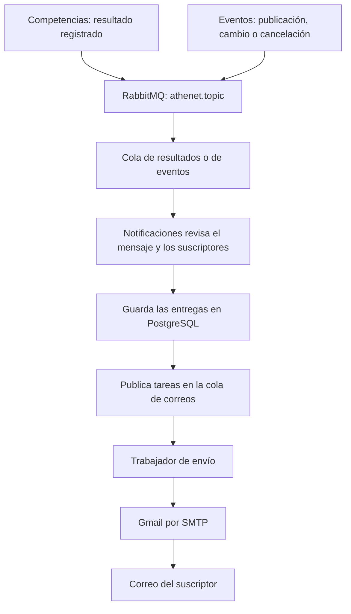

# Notificaciones de Athenet, explicado para el equipo

## ¿Para qué sirve este microservicio?

Notificaciones administra el boletín por correo de Athenet. Guarda quién quiere recibirlo y prepara los mensajes cuando se informa un resultado o un cambio en un evento deportivo.

Por ejemplo: se registra un resultado 2–1 en Competencias. Competencias avisa mediante RabbitMQ y Notificaciones prepara un correo para cada suscriptor activo. Competencias no necesita conocer sus direcciones ni conectarse a Gmail.

Las responsabilidades quedan así:

| Servicio | Responsabilidad |
| --- | --- |
| Competencias | Guardar partidos y resultados, avisar que se registró o corrigió un resultado |
| Eventos | Guardar eventos; avisar publicaciones, modificaciones y cancelaciones |
| Notificaciones | Administrar suscripciones, decidir qué correos corresponden y enviarlos |

## ¿Qué construimos?

### 1. Suscripción, confirmación y baja

Una persona entrega su correo, acepta recibir el boletín y completa Turnstile, la comprobación contra registros automatizados. Notificaciones guarda la solicitud y envía un enlace de confirmación.

La suscripción comienza en `PENDING`, pasa a `ACTIVE` cuando la persona confirma y queda en `UNSUBSCRIBED` al darse de baja.

La confirmación comprueba que la persona tiene acceso al correo ingresado. Cada correo del boletín incluye un enlace para cancelar. Antes de enviar, se vuelve a comprobar si la suscripción sigue siendo válida.

### 2. Avisos de resultados

Se prepara un correo al recibir un resultado nuevo. Si llega una corrección posterior, se identifica como resultado corregido. El mensaje muestra equipos, marcador, competencia, ronda y puntos cuando corresponde.

También se guarda la versión procesada. Si un mismo resultado vuelve a llegar o llega una versión antigua, se evita preparar el mismo aviso otra vez. Esto importa porque las colas pueden entregar mensajes repetidos.

### 3. Avisos de eventos deportivos

Se implementaron avisos de publicación, modificación y cancelación para `MATCH` y `TRACKDAY`. Los borradores, `MEETING` y `OTHER` quedan fuera del boletín.

Se usan los mismos suscriptores del boletín de resultados. Por ahora no hay preferencias separadas. Un evento tiene un solo aviso inicial: republicarlo no genera otro aviso de estreno. Un cambio relevante, como horario o lugar, sí puede generar un aviso de modificación.

Estos correos no llevan enlace al detalle del evento, según el alcance acordado. Sí incluyen el enlace de baja.

## ¿Cómo viaja un aviso?

Hay dos trabajos distintos: decidir qué avisar y enviar cada correo. Separarlos permite que una demora de Gmail no obligue a Competencias o Eventos a esperar el envío a todos los suscriptores.

## ¿Por qué elegimos estas herramientas?

| Herramienta o decisión | Para qué se usa y por qué se eligió |
| --- | --- |
| Spring Boot y Java | Construir la API y los consumidores con la misma base tecnológica de los otros microservicios |
| RabbitMQ | Comunicar novedades sin que cada productor tenga que llamar directamente al servicio que envía correos |
| Exchange `topic` | Compartir un punto de publicación y separar los mensajes mediante nombres como `resultado.registrado` o `evento.publicado` |
| PostgreSQL en RDS | Conservar suscriptores, estados y entregas aunque se reinicie la aplicación |
| SMTP con Gmail | Enviar correos reales usando una cuenta remitente y su contraseña de aplicación |
| Docker | Ejecutar el servicio con su versión de Java y sus dependencias dentro de una imagen |
| Compose en EC2 | Mantener en archivos la configuración de ejecución, reinicio y límites del contenedor |
| GitHub Actions | Automatizar las pruebas, la construcción de la imagen y el despliegue al integrar cambios en `main` |

El exchange recibe y dirige mensajes; las colas los guardan hasta que un consumidor los procesa. Usar un exchange `topic` no obliga a usar comodines: las colas de Notificaciones están enlazadas con los nombres exactos que necesitan.

## ¿Qué guarda en la base de datos?

Sí: **guarda los correos de los suscriptores del boletín**. También conserva la información necesaria para administrar sus permisos y seguir las entregas.

| Información | Para qué se conserva |
| --- | --- |
| Correo, consentimiento y estado de suscripción | Saber quién solicitó el boletín y quién puede recibirlo |
| Datos de confirmación y baja | Activar o cancelar la suscripción mediante sus enlaces |
| Destinatario, asunto y cuerpo de cada entrega | Saber qué correo se preparó |
| Estado, intentos y errores de entrega | Distinguir correos pendientes, enviados, omitidos o fallidos |
| Última versión de resultados y eventos | Evitar preparar avisos repetidos o antiguos |
| Eventos de confirmación pendientes de publicar | Poder volver a intentar su publicación si falla |

No reemplaza las bases de Competencias ni Eventos. Conserva lo que necesita para el boletín.

## ¿Qué pasa si algo falla?

Los mensajes que fallan al procesarse tienen reintentos. Si no se resuelve el problema, pueden terminar en una **DLQ**, una cola de errores donde quedan para revisión. La DLQ no corrige ni reenvía automáticamente el mensaje.

Las tareas de correo se guardan antes de publicarlas. Así, Notificaciones puede reintentar publicaciones pendientes. El estado `SENT` indica que la aplicación completó el envío por SMTP; no demuestra que la persona haya abierto el correo ni que haya llegado a la bandeja principal.

Hay dos límites que debemos conocer:

- El publicador de Eventos envía después de guardar el cambio, pero no tiene una bandeja persistente de mensajes pendientes. Si RabbitMQ falla justo en ese momento, el evento puede quedar guardado sin que salga su aviso.
- El envío SMTP y la actualización de PostgreSQL son operaciones separadas. Aunque se controlan versiones y duplicados, no se garantiza que nunca pueda repetirse un correo ante una caída en un momento crítico.

## Comparación con la demo del profesor de RabbitMQ

La demo enseña cómo funcionan los exchanges `direct`, `fanout` y `topic`, los consumidores y las colas de errores. Athenet aplica esos conceptos a un caso concreto: enviar un boletín.

| En la demo                                                    | En Notificaciones                                                                                               |
| ------------------------------------------------------------- | --------------------------------------------------------------------------------------------------------------- |
| Una petición publica un mensaje de ejemplo                    | Un cambio de negocio en Competencias o Eventos origina un aviso                                                 |
| Los consumidores anotan lo recibido para mostrarlo en una API | Los consumidores preparan entregas y gestionan el envío SMTP                                                    |
| Se muestran varios tipos de exchange                          | Se usa `topic` para organizar los tipos de mensajes del sistema                                                 |
| Se demuestra el rechazo manual en un consumidor de pedidos    | Se usa confirmación automática de Spring junto con transacciones y políticas de reintento                       |
| Se demuestra una DLQ, incluido el vencimiento por TTL         | Se usan DLQ para aislar fallos; no se copió el vencimiento corto de los ejemplos                                |
| La demostración permite observar mensajes                     | El servicio agrega suscripciones, consentimiento, base de datos, control de versiones y seguimiento de entregas |

Confirmación automática no significa confirmar apenas llega el mensaje: Spring decide la confirmación según cómo termina su procesamiento y cómo se manejan los errores.

## ¿Qué está listo y qué falta?

Se implementaron y probaron localmente el registro, confirmación, baja, avisos de resultados y avisos deportivos. Notificaciones ya se ejecuta en su EC2 con Docker. Se comprobaron el acceso HTTP, la autenticación con RabbitMQ y Gmail, y los consumidores de resultados, correos y eventos.

Queda pendiente completar la integración del frontend, configurar HTTPS y actualizar/activar el publicador de Eventos en la nube. Por eso, tener el consumidor de eventos conectado no demuestra todavía el recorrido completo desde Eventos desplegado hasta un correo recibido.
